<p align="center"></p>

<p align="center">
  <a href="https://github.com/T-Crypt/skills-gate/actions/workflows/test.yml"></a>
  
  
  
  
  <a href="LICENSE"></a>
</p>

<p align="center">
  <a href="#quick-start">Quick start</a> &nbsp;·&nbsp; <a href="#how-it-works">How it works</a> &nbsp;·&nbsp; <a href="#what-it-does">What it does</a> &nbsp;·&nbsp; <a href="#the-marketplace-catalog">Marketplace</a> &nbsp;·&nbsp; <a href="#compared">Compared</a> &nbsp;·&nbsp; <a href="#commands">Commands</a> &nbsp;·&nbsp; <a href="#config">Config</a> &nbsp;·&nbsp; <a href="#layout">Layout</a>
</p>

# skills-gate

**One skill in front of all of them.** Coding agents load every skill folder they can see. Install a
hundred skills and each session starts by paying for a hundred descriptions, while the agent picks
from a menu too long to read. skills-gate moves every skill into a bank and leaves one skill in view:
the gate. When you type a task, a prompt hook ranks the bank and names the two or three skills that
fit. The agent pulls in a full playbook only when it needs one, and a nightly pass retires what
nobody uses.

On the machine it was built on, 148 skills cost 14,250 tokens of listing in every session. Behind the
gate they cost 389.

One Python file, standard library only, a SQLite registry. No GUI, no daemon, no model, no GPU.

## Quick start

```bash
git clone https://github.com/T-Crypt/skills-gate
ln -s "$PWD/skills-gate/bin/skills-gate" ~/.local/bin/skills-gate
skills-gate init               # ~/.skills-gate, plus the gate skill in every harness folder found
skills-gate gate --dry-run     # what would move behind the gate
skills-gate gate               # move it (undo: skills-gate ungate)
skills-gate hook --write       # Claude Code: rank the bank on every prompt
skills-gate timer              # nightly tidy + marketplace refresh (systemd user timer, or cron)
skills-gate market refresh --budget 2000   # optional: validate the most popular 2,000 now (~10 min)
```

Then work as usual. When a prompt matches, the agent sees a short note before it starts:

```text
skills-gate: banked skills that match this request. If one fits, load it with
`skills-gate use <name>` before you start; ignore them if they do not fit.
- code-review [core]: Review the changes since a fixed point (commit, branch, tag, or merge-base) ...
```

## How it works

<p align="center"></p>

1. **You type the task.** In Claude Code the `UserPromptSubmit` hook passes the prompt to
   `skills-gate suggest --hook`. It answers in about 80 ms and prints nothing when no skill clears
   the bar, so most prompts cost nothing.
2. **The bank gets ranked.** BM25 runs over each skill's name, description, lane and playbook
   headings. A word that is rare among skill *names* counts extra, so "write a skill" finds
   `skill-creator` even though nearly every description says "skill". Skills already on in the
   project, and the always-on set, never get suggested twice.
3. **The agent loads what fits.** `skills-gate use <name>` prints the playbook once and changes
   nothing on disk. `skills-gate on <name>` links it into the project for a run of work, and
   `--save` writes it to the project's `.skills-gate.json`.
4. **The tidy keeps score.** Every load, from any harness, counts. Skills switched on but idle for
   14 days switch off, and skills nobody has loaded in 120 days move to cold storage, unless you
   pinned them or something references them.

Harnesses without hooks still see the gate skill. Its body lists every lane and every skill name,
so an agent can choose without a second call. Harnesses without a shell can use `skills-gate mcp`.

## What it does

**Finds the right skill**
- **Prompt-time suggestions.** `suggest` ranks the bank for a task; `suggest --hook` reads Claude
  Code's hook payload and never blocks or fails a prompt. `hook --write` and `hook --remove` edit
  `~/.claude/settings.json` and keep a backup.
- **Measured, not guessed.** `bench cases.jsonl` scores the ranker on your own prompts: recall@1,
  recall@k, MRR, and how often a suggestion fires and is right. On 28 real prompts against a
  148-skill bank: recall@3 0.93, and 25 of 26 fired suggestions named a correct skill. That bench
  also tuned the defaults, so treat the numbers as a ceiling until you run your own.
- **Lanes with names.** The gate skill carries a lane table plus every skill name per lane;
  `lane <name>` adds one line per skill with size, uses and risk.

**Counts real use, everywhere**
- **Usage from every harness.** `tidy` reads tool calls from Claude Code, Pi, OMP and Codex session
  logs: the Skill tool, and any call that opens a `<skill>/SKILL.md`. It reads tool names and
  arguments, never message text, and counts each call once even when a resumed session copies
  history into a new file.
- **References hold skills.** A skill named in your role prompts (`skills-gate/bank/<x>`,
  `skills-gate use <x>`), linked from another tool's folder, or listed in a project manifest never
  goes cold. `remove` refuses it without `--force`, and `show` says who depends on it.
- **`stats`.** Loads per harness, the most used skills, what goes cold in the next 30 days, the
  suggestion hit rate, and what the trust layer did in the window: blocked calls, approvals, holds.

**Installs carefully**
- **A marketplace you can trust offline.** A local catalog of every skill skills.sh lists (20,000 on
  the day this shipped), refreshed nightly and validated skill by skill before search offers it. See
  [the marketplace catalog](#the-marketplace-catalog). `search --market --live` asks skills.sh and
  `gh skill search` directly, merges and caches the answers for a day.
- **An install scan.** Before any skill reaches the bank, skills-gate checks every file for
  pipe-to-shell, decode-and-run, reverse shells, credential reads, env exfiltration, destructive
  commands, prompt injection, hidden or bidirectional unicode, encoded blobs and executables.
  Scripts and docs get different rules. A high finding blocks the install until you pass
  `--allow-risky`; a remote install needs `--yes`, which an agent passes only after you agree.
  `audit` scans the whole bank and records a risk level per skill.
- **Updates you can read first.** Remote installs record `url#path@commit`. `outdated` checks
  upstream with `git ls-remote`, `diff` shows the change, and `update` scans the new version,
  keeps the old copy in `cold/` and refuses to overwrite your local edits without `--force`.

**Never calls out without approval**
- **Egress needs your yes.** Every bank skill is scanned for the hosts it would dial. The default
  policy is `deny`: a skill that calls an external host is held at install, and `use` prints a
  warning telling the agent not to run its network commands until you approve (`skills-gate net`,
  `skills-gate net allow <skill> [host]`). Local and tailnet addresses never count, and XML
  namespace URIs (OOXML, W3C, Dublin Core) are recognized as identifiers, not call targets.
- **Quarantine first.** A new or updated skill is vetted in `quarantine/`: install scan, egress
  against your approvals, then an optional local-model reviewer. Nothing reaches the bank while a
  block stands; `quarantine release <entry>` after you read the report.
- **A local reviewer, not a cloud one.** Point `trust.review_cmd` at any command that reads the
  skill folder and answers one JSON line. The bundled `skills-gate-review` asks your llama-swap
  `review` model to judge the skill as untrusted agent content: telemetry, exfiltration, prompt
  injection, obfuscation. The skill is read, never run; when the model is down the verdict is
  `skipped`, never a guess. `review --changed` vets by hand; with a reviewer configured the
  nightly `tidy` reviews up to `trust.nightly_review` changed skills by itself.
- **The gate skill states the rule.** Every harness sees the same instruction: a skill never
  calls out without your approval, and agents may never pass `--allow-net` or `--allow-risky`.
- **You can audit the week.** Blocked uses, approvals, revokes and holds land in an event log;
  `stats --days 7` sums them next to usage and the suggestion hit rate.

**Fits how you work**
- **Project manifests.** `.skills-gate.json` lists a project's skills and where to get them.
  Commit it; `project sync` on another machine installs what is missing and links the rest.
  Project links go into `.git/info/exclude`, never into your `.gitignore`.
- **Presets and lanes.** `preset save review-kit code-review blast-radius`, then
  `on --preset review-kit` or `on --lane media`.
- **One bank on every machine.** Point every machine at one private git repo and they act as peers:
  `skills-gate join <git-url> --all` on a new machine sets the remote, takes the bank, gates the
  harness folders, writes the hook and installs the timers. A three-way merge per skill takes the
  side that changed; when both changed, skills-gate keeps yours, saves theirs in `conflicts/` and
  waits for `--theirs` or `--mine`. The same merge runs key by key over the shared settings
  (always-on set, prune and cold windows, trust policy, suggestion tuning, marketplace), network
  approvals and revokes, presets, and each skill's lane and pin. Paths stay per machine. A skill
  banked on one peer is banked on every peer: the content scan still runs on arrival, and a skill
  whose network use you have not approved arrives with the same `use` warning it has at home,
  not as a quarantine hold. Each peer reports its usage and its references, so the nightly tidy
  sends a skill to cold storage only when no machine has used, pinned or referenced it.
  `skills-gate peers` lists the machines and says whether this one is in step. The timer pulls
  before the tidy and pushes after it, and an hourly push keeps peers in step during the day; a
  push with nothing new makes no commit. Secrets (`.env`, keys, tokens) and files
  over 10 MB stay home, and an empty remote never empties your bank.
- **16 known harnesses.** `agents` lists Claude Code, the shared `~/.agents` folder, Codex,
  OpenCode, Pi, OMP, Cursor, Gemini, Copilot, Windsurf, Roo, Cline, Goose, Kiro, Qwen and Trae,
  with what is installed and what is gated. `agents add cursor` gates one more.
- **MCP.** `skills-gate mcp` serves `skills_suggest`, `skills_use`, `skills_search`, `skills_lane`,
  `skills_show`, `skills_on` and `skills_off` over stdio. Skip it in harnesses with a shell: the
  CLI costs no context until called, and seven tool schemas do.

## The marketplace catalog

`skills-gate market refresh` runs every night after the tidy, in two passes.

1. **Gather.** It reads the skills.sh sitemaps (about 1.7 MB) and any repos you list in
   `market.repos`, your own org or a private one. A skill it has not seen before gets a first-seen
   date.
2. **Validate.** Up to `market.budget` skills per night (400 by default), the most popular first,
   then anything last checked 14 days ago. For each one skills-gate reads the repo's metadata and
   file tree, finds the skill's folder (by folder name, or by the `name` in each SKILL.md), fetches
   the real SKILL.md and judges it:

   | Check | Result |
   |---|---|
   | front matter has a usable `name` and a `description` | fail without them |
   | the install scan on the playbook text (injection, hidden unicode, pipe-to-shell, ...) | high finding: fail; medium: warn |
   | description length, playbook length, file size | warn when thin or huge |
   | binaries in the folder, folder over 20 MB, archived repo | warn |
   | listed on skills.sh but gone from the repo | fail |
   | scripts present, no licence, name differs from the listing | noted |

   When a skill's SKILL.md changes upstream, the next check marks it updated.

The first run validated 150 skills in 44 seconds with about 50 GitHub API calls; raw file
reads cost no quota. `gh` makes the calls authenticated (5,000 an hour); without it, set
`GITHUB_TOKEN` or the budget will hit GitHub's 60-an-hour limit.

```bash
skills-gate market                 # stats: how many ok, warn, fail, still unchecked
skills-gate market new --days 7    # what arrived or changed this week, validated
skills-gate market show anthropics/skills:pdf    # the verdict and every reason
skills-gate market validate owner/repo:skill     # check one now
skills-gate search "pdf forms" --market          # ranked from the catalog, failures hidden
```

`add` checks the catalog too: a skill that failed validation needs `--allow-risky`, and every
install still runs the full scan over all its files.

## Compared

skills-gate started from [xingkongliang/skills-manager](https://github.com/xingkongliang/skills-manager)
(MIT): a central library deployed into many agents through a desktop app. It keeps the library and
inverts the default. Nothing loads until a task needs it.

| | skills-gate | skills-manager | `gh skill` |
|---|---|---|---|
| Default | everything banked, one gate visible | deploy chosen skills per agent | install into agent folders |
| Picks skills for a prompt | yes, prompt hook + `suggest` | not listed | no such command |
| Retires unused skills | from usage in 4 harnesses' logs | not listed | no such command |
| Marketplace | local catalog of 20k skills, validated nightly | browse skills.sh | `search` (GitHub code search) |
| Scan before install | yes, blocks high findings | not listed | `preview` to read first |
| Updates | `outdated` / `diff` / `update` | upstream check | `update` |
| Multi-machine | git push / pull, merge per skill | git backup and sync | not listed |
| Interface | CLI, hook, MCP | desktop app + CLI | CLI |
| Agents | 16 known, any folder | 56 built in | Copilot, Claude Code, Cursor, Codex, Gemini CLI, Antigravity |

Pick skills-manager for a GUI and the widest agent list. Pick skills-gate when context cost and
choosing the right skill matter more than seeing every skill at once. They can share a machine:
`skills-gate adopt <its library folder>` banks its library.

## Commands

| Command | What it does |
|---|---|
| `init` | Create the home, config and database; link the gate into every harness folder found |
| `gate [--dry-run]` / `ungate` | Move every skill behind the gate, keeping the always-on set / put it all back |
| `suggest "<task>" [--all] [--json]` | The banked skills that fit, ranked; `--hook` for prompt hooks |
| `hook [--write \| --remove]` | Print, install or remove the Claude Code prompt hook |
| `use <skill>` | Print a skill's playbook into the session |
| `on` / `off <skills> [--lane L] [--preset P] [--global] [--save]` | Link skills into a project or every harness |
| `search <words> [--market] [--live] [--offline]` | Search the bank, the validated catalog, or the marketplaces live |
| `market [refresh \| new \| show \| validate \| stats]` | The marketplace catalog: gather, validate, browse |
| `add <folder \| git-url \| owner/repo[/path][:skill][@ref]>` | Install: scan, ask, bank. `--yes`, `--allow-risky`, `--only`, `--link`, `--lane` |
| `adopt <folders>` | Bank every skill already sitting in existing folders |
| `scan <skill \| folder>` / `audit` | Install checks on one skill / on the whole bank |
| `net [list \| allow \| revoke \| hosts]` | Which skills call out, and what you approved |
| `review <skills \| --all \| --changed> [--static]` | Vet bank skills again: scan, egress, reviewer |
| `quarantine [list \| release \| rm]` | Skills held back by vetting |
| `outdated` / `diff <skill>` / `update <skills \| --all>` | Upstream changes, read them, take them |
| `project show \| save \| sync` | The project's `.skills-gate.json` |
| `preset list \| show \| save \| add \| rm` | Named skill sets |
| `remote <url>` / `push` / `pull [--theirs \| --mine]` | Sync the bank through git |
| `join <url> [--all]` / `peers` | Make this machine a peer of a bank / every peer and whether this one is in step |
| `agents [add \| remove \| ignore] <name>` | Known harnesses and which ones are gated; `ignore` hides one for good |
| `lane [name]` / `set-lane <lane> <skills>` | Read or change the lanes |
| `pin` / `unpin` / `remove <skills>` | Exempt from pruning / move to cold storage |
| `tidy [--fix] [--dry-run]` | The nightly pass; `--fix` re-gates leaks |
| `harvest [--reset]` | Count skill loads from session logs now; `--reset` recounts everything |
| `stats [--days N]` / `bench <file>` | Usage, trust events and suggestion hit rate / ranker quality on your prompts |
| `status` / `doctor` / `show <skill>` | Inspect |
| `mcp` / `timer` / `reindex` | MCP server / install the nightly timer / re-read every skill |

## Config

`~/.skills-gate/config.json`. Keys you leave out keep their defaults; set a harness folder to `""`
to leave it alone.

```json
{
  "always_on": ["find-docs"],
  "prune_days": 14,
  "cold_days": 120,
  "harness_dirs": {"claude": "~/.claude/skills", "agents": "~/.agents/skills"},
  "project_dirs": [".agents/skills", ".claude/skills"],
  "usage_sources": {"claude": "~/.claude/projects", "codex": "~/.codex/sessions"},
  "ref_roots": ["~/dotfiles/agents/prompts"],
  "marketplace": ["skills.sh", "gh-skill"],
  "market": {"sources": ["skills.sh"], "repos": ["my-org/agent-skills"], "budget": 400, "revalidate_days": 14},
  "suggest": {"limit": 3, "min_score": 7.0, "ratio": 0.55},
  "trust": {"egress": "deny", "allow_hosts": [], "review_cmd": "", "review_timeout": 600,
            "review_pending": "allow", "nightly_review": 20}
}
```

`min_score` fits a bank of about 150 skills; skills-gate scales it down for smaller banks. Raise it
if suggestions feel noisy, and check the effect with `bench`.

`trust.egress` is `deny` (default), `warn` or `allow`. `allow_hosts` applies to every skill; the
per-skill approvals live in the database and travel with `push` / `pull`. `review_cmd` gets the
skill folder plus its name and answers one JSON line; the bundled `skills-gate-review` (llama-swap
on this box by default) is the usual value.

## Layout

```
~/.skills-gate/
  config.json        harness folders, always-on skills, sources, thresholds
  gate.db            registry: skills, lanes, usage, toggles, references, presets, events, the catalog
  bank/<skill>/      every skill (copies, or links to their source)
  cold/<skill>/      removed, pruned and replaced skills
  gated/             what `gate` moved, for `ungate`
  lanes/<lane>.md    one line per skill, read by `skills-gate lane`
  skill/skills-gate/ the gate skill, linked into every harness folder
  sync/              the git export `push` and `pull` work through
  conflicts/<skill>/ the other machine's copy after a conflict
```

Set `SKILLS_GATE_HOME` to keep it somewhere else.

## Privacy

Everything stays on your machine except what you ask for: `market refresh` downloads the skills.sh
sitemaps and reads public repos from GitHub (no query of yours leaves), `search --market --live`
sends the query to skills.sh and GitHub, `add` and `outdated` talk to the git hosts you install from, and `push` sends
your bank to the remote you set. Use a private repo for that remote.

## Tests

```bash
python3 -m unittest discover -s tests
```

33 end-to-end tests run every command in a throwaway home with fake harness folders, local git
repos as upstreams, a bare repo as the sync remote, and a faked GitHub for the catalog. CI runs them on Python 3.9 and 3.13.

## License

MIT
